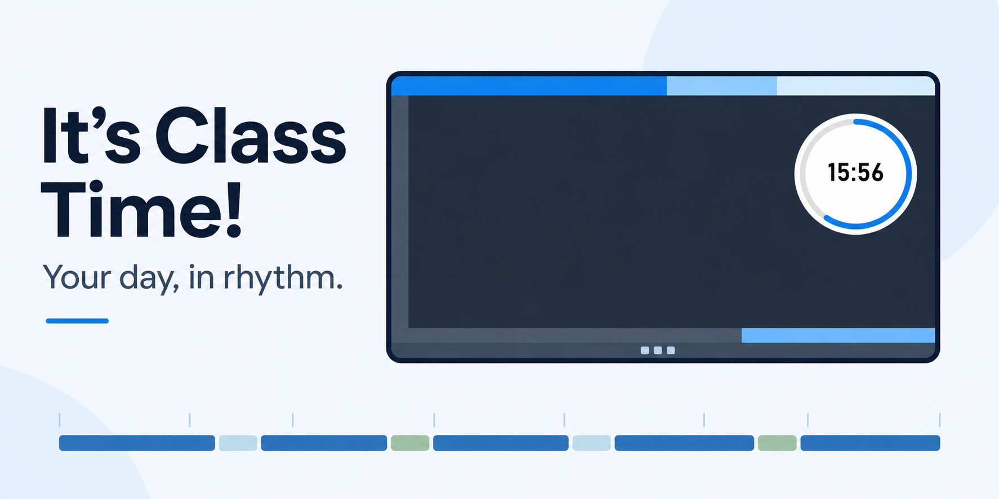
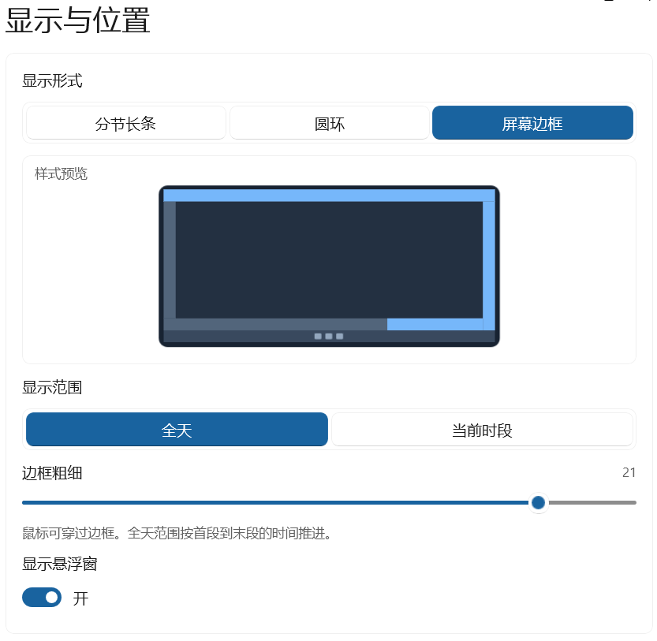

<div align="center">

# It's Class Time!

**“上课”时间到！** · 把课表的节奏，放回桌面上。

常驻屏幕边缘的原生小组件 · 分节进度 · 悬停详情 · 到点系统通知 · 完全离线


[它能做什么](#它能做什么) · [为什么做](#为什么做这个) · [装上试试](#装上试试) · [现在到哪一步](#现在到哪一步) · [文档地图](#文档地图) · [路线图](#路线图)

</div>



> 上图为产品宣传插画，实际界面请见下方截图。系统通知由操作系统绘制。

## 它能做什么

**It's Class Time!** 把你熟悉的上课铃声搬到桌面上。它不问你今天要完成什么，也不催你打卡，只做一件事：**让你随时知道现在是第几节、这一节走到哪儿了、还有多久能站起来走两步。**

时间线来自一张真实的课表——高中 45 分钟一节，或者大学 90 分钟一大课，中间有课间、有午休。它按本地时钟自己走，到点用系统通知提醒你上下课。

它**不是**番茄钟：没有“开始专注”按钮，没有 25 分钟倒计时，也不需要你每天手动开一轮。

不上学也能用。把模板改成你自己的节奏——上午两段深度工作、午休、下午一段长会——它本质上就是一张可编辑的时间表，只是默认长得像课表。

## 为什么做这个

写代码、写论文、改方案的时候，人对时间的感知会失真。抬头看一眼钟，你只知道“现在三点二十”，但真正想知道的是“这节还剩多久”“下一段休息什么时候来”。

常见做法是设一串闹钟，或者用番茄钟把一天切成等长的小块。可真实的课表不是等长的，午休也不是五分钟。闹钟设多了会麻木，设少了会错过；番茄钟则要求你不停地开始、结束、开始。

所以我们做了个很窄的东西：把课表本身放到屏幕边缘，让它安静地走。你不需要打开它，也不需要维护它——抬头就有答案。

## 你会看到什么

### 一眼读懂时间

- **分节长条**：每一节一根小条。上过的填满，正在上的按比例生长，没到的留白；课间是一小段不同颜色的间隔，午休是明显更长的分隔，不会被误画成一节课。
- **圆环**：一个主环，中心是剩余时间。只想知道“还剩多久”的时候用它。
- **屏幕边框**：沿显示器四边画一整圈进度，几乎不占地方（macOS 贴合整块屏幕四边且点击完全穿透，Windows 沿工作区四边避让任务栏）。全天可按各时段的时长分色，也可选择让进度颜色跟随当前是上课、课间还是午休。
- **Windows 显示细节**：可自定义阶段颜色、边框渐变与进度前沿高光，并选择全屏时隐藏或覆盖任务栏。
- **当前时段 / 全天**：屏幕小就只看这一段；想掌握整天节奏就全铺开。这只是展示过滤，提醒永远基于完整日程。

### 悬停才说话

鼠标停上去，才展开课程名、第几节、起止时间、已过与剩余、百分比、下一段预告。不悬停时保持最窄，不闪、不跳、不抢焦点。四条边都能吸附：上下保持横排，左右自动转成竖向排列。多屏时可在「显示与位置」选择组件所在的显示器，或跟随系统主显示器。默认紧贴任务栏或屏幕边缘，靠边一侧以小圆角接续；想要悬浮感可以关掉「紧贴边缘」。拖歪了？连续点三下它，沿当前边回到居中。

### 改得动的课表

- 高中 / 大学两份模板只是起点，全部可改：改名、改起止、增删时段、调午休，还能按星期启用，并可新增复制或空白的自定义模板。
- **数字框精确到 1 分钟，滑块按 5 分钟微调。** 手输 121 分钟不会被滑块悄悄改成 120。
- **作息时间轴**：拖动时段或两端调整时间，可选 1、5、15 分钟步进；也可复制时段并在空白处双击新增。
- **「仅今天」和「永久修改」分开放。** 临时调课不会污染常规模板；改模板也不会偷偷改掉今天。
- 改时长会影响到后面的课时，你可以选「顺延后续」或「后续保持原时间」；冲突就拦下来，并明确指出是哪一行。
- 分节长条可调整整体长度和背景色，也可恢复默认长度与系统/液态玻璃背景。

### 靠得住的提醒

- 由**常驻进程在边界到达时**调用系统通知，而不是提前把一整天的事件排进系统队列。
- 睡眠两小时再唤醒，只显示当下的状态，不会补发一串过期提醒。
- 同一下课瞬间的“下课了”和“课间开始”合并成一条，不刷屏。
- 一键暂停提醒：时间照走、进度照动，只是不响；恢复后不补发暂停期间的旧提醒。
- **Windows 可选视觉提醒**：到点时可显示边缘柔光或短暂的放大时钟。时钟可选翻页数字、机械、电子面板或罗马表盘，支持六款皮肤、自选颜色、三档大小和停留时间。两种提醒默认关闭；它们是系统通知之外的补充。

### 安静地待着

- 关掉设置窗口不等于退出，托盘 / 菜单栏一直在；从这里可以显示隐藏、切换视图、暂停提醒、退出。
- 单实例运行，不会出现两个进程各发一套通知。
- 换显示器、改缩放后，浮窗会回到仍然可见的工作区域。
- 开机启动是可选项，默认关闭，不会悄悄写启动项。
- 完全离线，配置就是一个本地 JSON。文件损坏时备份原件并回退到预设，而不是打不开。

> 上面写的是设计行为。其中睡眠唤醒、资源管理器重启和显示器热插拔等场景仍在逐项复核，状态以 [docs/ACCEPTANCE.md](docs/ACCEPTANCE.md) 为准——我们不把“代码写完”当成“验证通过”。

## 两个平台，两套原生

这个项目有一个不太流行的坚持：**不用 Electron、Tauri 或 WebView 做桌面壳。**

|  | Windows 11 | macOS |
|---|---|---|
| 语言与框架 | C++17 · C++/WinRT · WinUI 3 · Win32 | Swift · SwiftUI · AppKit |
| 常驻入口 | 托盘（`Shell_NotifyIcon`） | 菜单栏（`NSStatusItem`） |
| 悬浮窗 | WinUI 3 窗口 + `HWND_TOPMOST` + `WS_EX_NOACTIVATE` | `NSPanel`（浮动层级、不激活） |
| 通知 | `AppNotificationManager.Show` | `UNUserNotificationCenter`（`trigger: nil`） |
| 配置 | 本地 JSON，原子写入 | 本地 JSON，原子写入 |

一个仓库、两个独立工程。共享的只有 JSON Schema、预设和测试向量——不为了“代码复用”塞一个跨语言核心库或 IPC 服务进来。取舍写在 [docs/ARCHITECTURE.md](docs/ARCHITECTURE.md) 和 [docs/DECISIONS.md](docs/DECISIONS.md)。

## 现在到哪一步

当前处于 **0.1.x 持续迭代阶段**。下表记录 main 分支。Windows 的电子面板、罗马表盘、时钟大小与停留时间，以及登录启动和通知修复均在 v0.1.2 发布后加入。

| 部分 | 状态 |
|---|---|
| 作息时间引擎、编辑与冲突规则 | **双端通过共享测试向量与配置/时间轴/组件状态检查**（Windows 270 项、macOS 220 项，0 失败） |
| Windows 客户端 | 可构建、可安装、可常驻；长条 / 圆环 / 屏幕边框、设置窗口、托盘、悬停详情、拖动吸附已在实机核对 |
| Windows 系统通知 | 升级后的 Windows 安装版已在组件隐藏时核对到点合并消息，暂停和恢复投递通过；已实测关闭与恢复系统通知权限，勿扰场景待复核 |
| Windows 安装包 | 离线 EXE 可用；安装路径、快捷方式、覆盖安装、卸载保留课表已验证；**未签名** |
| macOS 客户端 | SwiftUI + AppKit 原生工程，支持 macOS 26+ Liquid Glass；配置恢复与单实例已通过冒烟验证，桌面交互与通知实弹**待逐项复核**。新增视觉提醒和部分外观选项目前为 Windows 专属 |
| macOS 安装镜像 | `ItsClassTime.app` 与离线 `arm64.dmg` 可本地构建并完成本机 Ad-hoc 签名校验；**未公证**，拖拽安装待实测 |
| CI 与双端 Release | Windows 与 macOS 安装包通过构建工作流生成，发行包及校验值见 [Releases](https://github.com/QuentinCrane/its-class-time/releases) |

> 时间语义的每一条规则都能在 [docs/FRD.md](docs/FRD.md) 找到出处，验证记录在 [docs/ACCEPTANCE.md](docs/ACCEPTANCE.md)。

### 界面实机截图（Windows）


*圆环视图：中心是本节剩余时间，底部是今日已完成的节数。*



*早期版本的显示设置截图；当前页面已调整为突出实时预览的布局。*

## 装上试试

### Windows

1. 到 [Releases](https://github.com/QuentinCrane/its-class-time/releases/latest) 下载 `ItsClassTime-<版本>-Windows-x64-Setup.exe`。
2. 双击安装，选择安装路径，可选创建桌面快捷方式。默认装到 `%LOCALAPPDATA%\Programs\ClassTime`，仅当前用户，并创建开始菜单项。
3. 首次启动选择高中或大学模板，再按你的真实课表改。
4. 关掉设置窗口。它会留在托盘里继续计时。

几点需要提前说明：

- 系统要求 Windows 10 1809（x64）及以上，主要面向 Windows 11。
- **安装包没有代码签名**，SmartScreen 可能拦一下；介意的话请从源码构建。
- 在没装 Windows App Runtime 的干净机器上，首次部署流程仍待验证。
- 卸载后个人课表保留在 `%LOCALAPPDATA%\ClassTime`，重装可继续用。

### macOS

1. 到 [Releases](https://github.com/QuentinCrane/its-class-time/releases/latest) 下载 `ItsClassTime-<版本>-macOS-arm64.dmg`，适用于 Apple Silicon Mac。
2. 双击镜像，将 `ItsClassTime.app` 拖入「应用程序（Applications）」文件夹后打开。
3. 首次启动在设置窗口挑选或新建作息模板，调整显示形态与通知权限。
4. 关掉设置窗口，它会留在顶部菜单栏继续计时（左键展开液态玻璃控制面板，右键打开快捷菜单）。

几点需要提前说明：

- 系统要求 macOS 13 Ventura 及以上（macOS 26/27 自动启用原生 Liquid Glass 外观与无障碍适配）。
- **镜像中的应用使用 Ad-hoc 签名，尚未公证（Notarization）**，从网络下载首次打开可能需在「系统设置 → 隐私与安全性」放行。
- 个人课表与设置保存在 `~/Library/Application Support/ClassTime`，升级或移除 `.app` 均不会删除课表。

## 从源码构建

**Windows**（C++/WinRT + WinUI 3，不需要 MSBuild 也能构建）：

```cmd
cd windows
tools\build-unpackaged.cmd
:: 产物：build\app\ClassTimeApp.exe
```

打离线安装包（需要 Inno Setup 7）：

```powershell
.\windows\tools\build-installer.ps1
```

完整的环境要求、依赖版本、已知限制和手工验收清单见 [windows/README.md](windows/README.md)。

**macOS**（Swift + SwiftUI + AppKit；构建需要 macOS 27 SDK，可使用对应的 Command Line Tools 或 Xcode；运行最低支持 macOS 13）：

```bash
# 构建原生应用包（产物：macos/build/app/ItsClassTime.app）
./macos/tools/build-app.sh

# 打离线安装镜像（产物：macos/build/release/ItsClassTime-<版本>-macOS-arm64.dmg）
./macos/tools/build-dmg.sh
```

完整的构建说明、工具链兼容细节与手工验收清单见 [macos/README.md](macos/README.md)。

两端都必须读取 `shared/presets/` 的预设，并跑通 `shared/test-cases/` 的同一组测试向量——时间规则不允许“各写各的”。

仓库结构：

```text
It'sClassTime/
├── windows/     # C++/WinRT 工程、作息引擎、测试、构建与打包脚本
├── macos/       # SwiftUI + AppKit 工程、作息引擎、测试、.app 与 .dmg 打包脚本
├── shared/      # 双端共用的 JSON Schema、预设、测试向量
├── docs/        # 产品、功能、设计、架构、验收文档
├── assets/      # 原型图与实机截图
└── AGENTS.md    # 给 AI 编码助手的硬约束
```

> 工程与配置标识（Windows：`ClassTime.sln`、`ClassTimeApp.exe`；macOS：`ItsClassTime.app`；配置目录均为 `ClassTime`）保持稳定，界面与文档中的产品名统一为 **It's Class Time!**（中文 **“上课”时间到！**）。

## 文档地图

| 文档 | 回答什么问题 |
|---|---|
| [docs/PRD.md](docs/PRD.md) | 为谁做、先做什么、明确不做什么 |
| [docs/FRD.md](docs/FRD.md) | 时间怎么算、边界怎么判、编辑与通知的确定性规则（可直接照着写代码） |
| [docs/DESIGN.md](docs/DESIGN.md) | 长什么样、悬浮层怎么交互、无障碍与系统视觉边界 |
| [docs/ARCHITECTURE.md](docs/ARCHITECTURE.md) | 两端各用哪些原生 API、为什么不做跨平台核心 |
| [docs/DEVELOPMENT.md](docs/DEVELOPMENT.md) | 本地怎么建工程、怎么发版、哪些步骤不能省 |
| [docs/ROADMAP.md](docs/ROADMAP.md) | 现在做到哪、下一个检查点是什么 |
| [docs/ACCEPTANCE.md](docs/ACCEPTANCE.md) | 怎么手工验收、双端一致性凭什么算通过 |
| [docs/DECISIONS.md](docs/DECISIONS.md) | 哪些已经冻结、哪些要等实测再定 |
| [docs/REFERENCES.md](docs/REFERENCES.md) | 用到的 Apple / Microsoft / GitHub 官方文档 |
| [AGENTS.md](AGENTS.md) | 给 AI 编码助手（也给人）的硬约束 |
| [windows/README.md](windows/README.md) | Windows 端的构建、验证边界与实现映射 |
| [macos/README.md](macos/README.md) | macOS 端的构建、打包与手工验收指南 |
| [shared/schemas/schedule.schema.json](shared/schemas/schedule.schema.json) | 作息 JSON 的结构契约 |
| [shared/presets/](shared/presets) | 高中 / 大学可编辑初始模板 |
| [shared/test-cases/time-engine.json](shared/test-cases/time-engine.json) | 双端共用的时间引擎测试向量 |

## 我们坚持不做的

产品边界也是产品的一部分。以下这些不是“以后再说”，而是明确不做：

- 不做账号、云同步、团队协作、数据看板。你的课表只在本机。
- 不做 AI 建议、待办管理、日历同步、打卡统计。
- 不提前把整天的通知排给系统，也不自己绘制伪系统通知。
- 不用 WebView / 浏览器内核当 UI，不为跨平台牺牲原生体验。
- 不用 1 秒一轮的后台忙轮询驱动作息，也不拿 UI 帧循环当计时器。
- 不承诺“零内存占用”。资源开销要测出来再说，测量记录写进验收清单。

## 路线图

| 阶段 | 目标 | 状态 |
|---|---|---|
| M0 | 原生技术可行性：常驻、浮窗、即时通知 | 双端主体已构建；Windows 浮窗与系统通知中心投递已核对；macOS 冒烟通过，桌面通知待复核 |
| M1 | 作息引擎：预设、校验、进度、下一边界 | 双端引擎检查通过（Windows 270 项、macOS 220 项）；常驻进程真实休眠唤醒待验 |
| M2 | 可日常使用的 MVP：三种视图、时间轴、双层编辑、暂停、开机启动 | 双端核心功能可用；Windows 另有部分外观与视觉提醒选项，桌面交互和通知实弹仍在复核 |
| M3 | 稳定性与发布：多显示器、单实例、CI、双端 Release | 提供双端离线安装包及构建工作流；签名公证与部分实机验收待完成 |

后续功能池（自定义铃声、更多主题、跨设备同步）不在首版范围内，需要单独立项。详见 [docs/ROADMAP.md](docs/ROADMAP.md)。

## 参与

- 如果这个东西正好解决了你的问题，点个 Star 就是最直接的鼓励；用着不顺手，欢迎开 Issue 说说卡在哪。
- 发现问题是好事：请开 Issue，并写清系统版本、显示缩放、课表形态和复现步骤。截图比描述有用。
- 提 PR 前请先读 [AGENTS.md](AGENTS.md)。改时间规则时必须同时更新 `shared/test-cases/time-engine.json`，否则两端会悄悄分叉。
- 建议标签：`windows`、`macos`、`shared-spec`、`bug`、`design`、`release`。一个需求可以拆成两个平台的子任务。

## 许可证

本仓库目前**尚未附带开源许可证**。引用需求文档与设计图时请注明出处。
