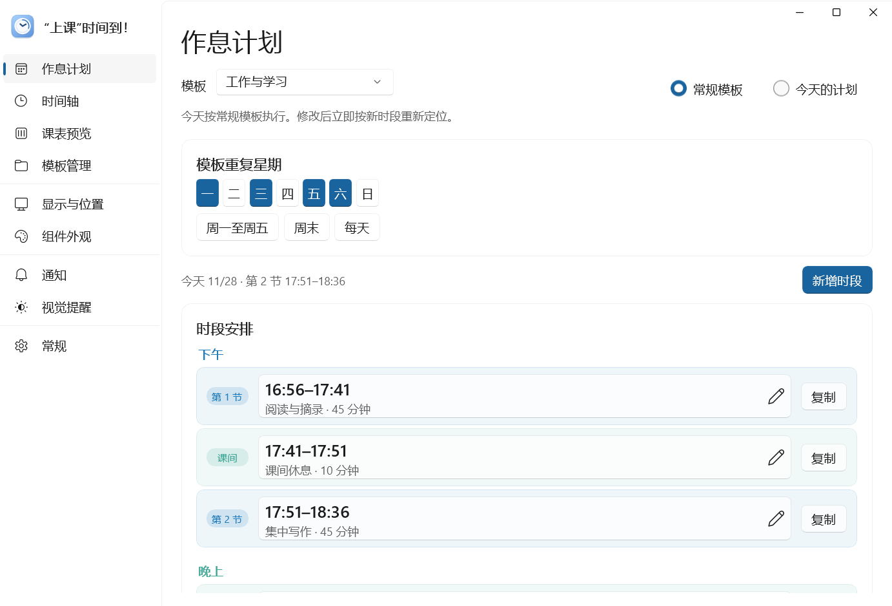

<div align="center">

# It's Class Time!

**“上课”时间到！**

把一天的作息放到桌面边缘。抬眼就能看到现在是第几节、还剩多久、下一段何时开始。

[下载与安装](#下载与安装) · [桌面与课表](#桌面与课表) · [版本与进度](#版本与进度) · [开发文档](#开发文档)

</div>


It's Class Time! 是 Windows 和 macOS 的原生桌面作息组件。选一份高中或大学模板，也可以排出自己的工作、学习和休息时段。课表跟随本地时钟运行，上课、下课和休息切换时可接收系统通知。课表和设置保存在本机，应用可离线使用。

## 下载与安装

当前发行版为 **v0.1.2**。下载页提供安装包和 SHA-256 校验值。 [GitHub Releases](https://github.com/QuentinCrane/its-class-time/releases/latest)

| 平台 | 下载 | 系统要求 |
| --- | --- | --- |
| Windows x64 | [离线安装程序（EXE）](https://github.com/QuentinCrane/its-class-time/releases/download/v0.1.2/ItsClassTime-0.1.2-Windows-x64-Setup.exe) | Windows 10 1809 或更新版本 |
| macOS Apple Silicon | [离线安装镜像（DMG）](https://github.com/QuentinCrane/its-class-time/releases/download/v0.1.2/ItsClassTime-0.1.2-macOS-arm64.dmg) | macOS 13 或更新版本 |

- **Windows** 双击 EXE，选择安装位置和桌面快捷方式。安装包随附 Windows App Runtime，默认安装到当前用户的 `%LOCALAPPDATA%\Programs\ClassTime`。该安装包未签名，SmartScreen 可能显示提示。
- **macOS** 打开 DMG，将 `ItsClassTime.app` 拖入「应用程序」。macOS 26 起可使用原生 Liquid Glass。应用采用 Ad-hoc 签名，Apple 公证待完成。首次打开时，可按系统提示前往「系统设置 → 隐私与安全性」确认。

打开设置，在「作息计划」选择模板并编辑时段，再到「显示与位置」选一种桌面视图。关闭设置后，可从 Windows 托盘或 macOS 菜单栏打开设置、切换视图、显示或隐藏组件、暂停或恢复提醒。

## 桌面与课表

### 看进度

| 视图 | 显示内容 |
| --- | --- |
| **分节长条** | 已结束的课节填满，当前课节随时间推进。课间与午休单独标记，悬停可查看起止时间、进度和下一时段。 |
| **圆环** | 中心显示当前时段的剩余时间。选「全天」可同时查看已完成课节数。 |
| **屏幕边框** | 沿 Windows 工作区或 macOS 屏幕四边显示进度。全天可按时段分色，也可让进度颜色跟随当前时段。 |

在「显示与位置」可切换「当前时段」和「全天」，选择显示器并查看实时预览。长条和圆环支持四边吸附、贴边收起及三击归中。侧边的长条会自动竖排。

### 排作息

- **常规模板与仅今天**各自保存。可自定义重复星期，也可从现有模板复制或新建空白模板。
- **时间轴**支持拖动时段及两端，步进可选 1、5、15 分钟。调整后可查看周课表和日课表。
- **精确到分钟**。可编辑起止时间、输入整数分钟，或用滑块按 5 分钟调整时长。需要改动后续时段时，可选择顺延或保持原时间。时间冲突会标出对应时段。

### 接收提醒

常驻应用在作息边界调用系统通知，同一时刻的下课和课间开始合成一条。暂停提醒时进度照常更新。恢复提醒或从睡眠唤醒后，应用从当前时刻定位下一条提醒。

Windows 的视觉提醒可在作息切换时显示边缘柔光或放大时钟。时钟支持选择样式、位置和配色。双端都可以在设置中开启登录启动。

## 版本与进度

### v0.1.2 之后的 Windows 更新

- **设置侧栏**提供作息计划、时间轴、课表预览、模板管理、显示与位置、组件外观、通知、视觉提醒和常规九个入口。作息相关页面共用计划范围，显示与外观页面共用顶部实时预览。
- **作息计划**支持周一至周五、周末、每天三个快捷项，也可逐日点选。点击时段列表里的起止时间可用 24 小时滚轮或键盘调整。
- **视觉提醒**新增电子面板和罗马表盘，可分别设置时钟大小与停留时间。离线 EXE 支持登录启动，通知页在返回应用时刷新系统权限状态。

### Windows 实机截图



*在作息计划页选择模板、勾选重复星期，或点击起止时间编辑时段。*


*圆环在全天范围内同时显示当前时段剩余时间与今日已完成节数。*

Windows 已实测三种视图、托盘键盘入口、系统通知权限切换与覆盖安装。macOS v0.1.2 已通过构建、签名校验和配置恢复冒烟测试。实机结果和待测项目见 [验收记录](docs/ACCEPTANCE.md) 与 [路线图](docs/ROADMAP.md)。

## 从源码构建

**Windows** 使用 C++/WinRT、WinUI 3 和 Win32。还原 NuGet 依赖并生成投影头文件后，在仓库根目录运行以下命令。 [Windows 构建指南](windows/README.md)

```powershell
.\windows\tools\build-unpackaged.cmd
# 构建离线安装包，需要 Inno Setup 7
.\windows\tools\build-installer.ps1
```

**macOS** 使用 SwiftUI 和 AppKit。构建需要提供 macOS 27 SDK 的 Command Line Tools 或 Xcode。 [macOS 构建指南](macos/README.md)

```bash
./macos/tools/build-app.sh
./macos/tools/build-dmg.sh
```

两个原生工程分别位于 `windows/` 和 `macos/`，共用 `shared/` 下的 JSON Schema、预设与时间引擎测试向量。

## 开发文档

| 文档 | 内容 |
| --- | --- |
| [产品需求](docs/PRD.md) · [功能规格](docs/FRD.md) | 使用场景、作息编辑、时间计算与提醒规则 |
| [设计规范](docs/DESIGN.md) · [架构](docs/ARCHITECTURE.md) · [决策](docs/DECISIONS.md) | 桌面交互、设置结构和双端原生实现 |
| [开发与发行](docs/DEVELOPMENT.md) · [官方资料](docs/REFERENCES.md) | 本地构建、运行测试、打包和发布流程 |
| [路线图](docs/ROADMAP.md) · [验收记录](docs/ACCEPTANCE.md) | 阶段目标、实机记录和复测步骤 |
| [作息 Schema](shared/schemas/schedule.schema.json) · [内置模板](shared/presets) · [共享测试向量](shared/test-cases/time-engine.json) | 双端约定与样例 |

欢迎用 [Issue](https://github.com/QuentinCrane/its-class-time/issues) 反馈使用问题，附上系统版本、显示缩放、视图和复现步骤。提交改动前请阅读 [协作说明](AGENTS.md)。修改时间规则时同步更新共享测试向量。

## 许可证

许可证待补充。
