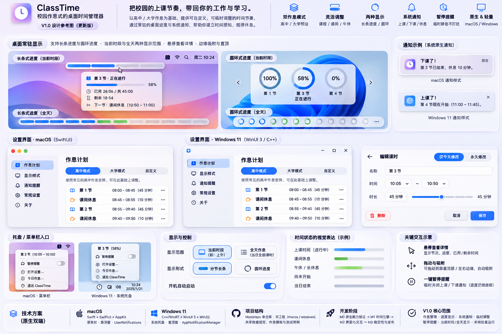

# DESIGN｜视觉原型与交互规范

> 视觉原型记录双端组件与交互方向。当前 Windows 作息计划和圆环见项目首页。 [实机截图](../README.md#windows-实机截图)



## 1. 整体设计方向

- 关键词：**安静、轻量、可感知、原生、留白、低打扰**。
- 悬浮组件优先显示时段状态和进度。设置窗口集中处理课表、外观与提醒。
- 使用系统字体、颜色和交互控件；课程强调色优先随用户系统主题变化，休息采用温和的次强调色。
- macOS 使用 SwiftUI、AppKit 与系统 Liquid Glass 外观。Windows 使用 WinUI 3 和 Fluent 控件。

## 2. 原型对应的版块

| 区域 | 原型位置 | 对应功能 |
|---|---|---|
| macOS 桌面展示 | 左上 | 贴边长条 + hover 信息 + 菜单栏常驻 |
| Windows 11 桌面展示 | 右上 | 贴边长条 + hover 信息 + 托盘常驻 |
| 分节条/圆环 | 中部左侧 | 两种时间显示形式 |
| 系统通知示意 | 中部右侧 | 通知外观与可见性由操作系统决定 |
| 两端设置窗口 | 下方左、中 | 作息、显示、通知与常规设置 |
| 自定义作息表 | 下方右 | 名称、起止、时长、编辑与保存 |
| 交互小样 | 最底部 | 休息、hover、吸附、开机启动 |

## 3. 悬浮长条

### 默认态

- 保持极窄、细条分节、不遮挡大面积桌面；已完成/当前/未来明显区分。
- 默认不显示永久大段文本；仅在 hover 时展示更多信息。
- 已完成段可以使用实心填充，当前段使用渐进填充，未开始段使用淡底；休息时使用小间隔或异色细节。
- 不使用不停闪烁、跳跃或无意义粒子动画；动效是状态反馈，不是注意力争夺。

### Hover 与交互

- 某节 hover：小卡片呈现名称、第 N 节、实际开始和结束、已过/剩余、进度 %、下一时段。
- 展开详情不得让悬浮窗持续反复改变宽度，避免窗口抖动。
- 拖动到屏幕可用区域的任意一条边时吸附；顶部/底部保持横向分节，左侧/右侧转为竖向分节，窄而高，不横跨内容。记忆显示器、边缘与沿边位置。
- 左右竖向排列时，悬停卡向屏幕内侧展开并纵向跟随鼠标所在分节；圆环只改变停靠边，形状不变。
- 连续三击悬浮条或圆环，沿当前边平滑回到居中位置；不改变停靠边，避免用户为了对齐而反复拖动。
- 默认与屏幕边缘/任务栏**无缝衔接**：靠边一侧以小圆角接续，另一侧保持胶囊弧度；关闭「紧贴边缘」后恢复 12 DIP 悬浮间距，回到“浮在桌面上”的观感。
- 当窗口可能覆盖重要内容，用户可菜单中隐藏并随时恢复。
- 在 macOS 全屏/Spaces、Windows 独占全屏遵守系统限制，不采用破坏性的强制置顶技巧。

## 4. 圆环

- 主环显示当前时段的进度，中心显示剩余时间。空档显示下一时段的开始时间。
- 进度颜色对应课程、课间或午休。选择「全天」时，圆环补充显示已完成课节数。

屏幕边框沿显示器四边绘制。当前时段范围显示这一段的进度，全天范围可按时段分色。macOS 沿完整屏幕绘制，Windows 沿工作区绘制，点击穿过边框。

## 5. 设置窗口结构

| 设置内容 | Windows | macOS |
|---|---|---|
| 作息 | 作息计划、时间轴、课表预览、模板管理分别有侧栏入口。前三页共用计划范围。 | 「作息计划」内提供模板、编辑器、时间轴和周/日课表。 |
| 显示 | 「显示与位置」设置形态、范围、显示器和贴边行为。「组件外观」设置尺寸、背景和配色。两页共用顶部实时预览。 | 「显示与位置」集中显示桌面预览、形态、范围、显示器、贴边与配色。 |
| 提醒 | 「通知」管理提醒时机、暂停和系统权限。「视觉提醒」设置并测试边缘柔光与放大时钟。 | 「通知」管理提醒时机、暂停和系统权限。 |
| 常规 | 登录启动、本地数据路径、版本与退出。 | 登录启动、本地数据路径、版本与退出。 |

Windows 作息计划页显示整张模板的重复星期及分组时段。点击列表里的起止时间可打开编辑器，用 24 小时制滚轮或键盘输入精确时刻。

## 6. 作息编辑器细节

```
午休             12:00 — 14:00
持续： [ 120 ] 分钟   [──────●────────] (滑动条)
作用： (●) 仅今天   ( ) 永久修改模板
后续： (●) 顺延后续  ( ) 后续保持不变
[取消]                                [保存调整]
```

- 时间输入、分钟数与滑动条显示同一份草稿。数字输入精确到 1 分钟，滑块按 5 分钟调整。
- 拖动滑块时预览时间变化，保存后应用于真实日程和提醒。
- 编辑冲突时标出对应时段，用户可选择顺延后续或保持原时间。

## 7. 设计状态矩阵

| 当前状态 | 长条 | 圆环 | hover 内容 |
|---|---|---|---|
| 尚未开始 | 未填充 | 空态 | 下一节及开始时间 |
| 学习/上课 | 当前节部分填充 | 当前课程百分比 | 已过/剩余/第 N 节 |
| 短课间 | 上一节完成 + 休息指示 | 休息进度 | 下一节开始时间 |
| 午休/长休息 | 分组明显分界 | 休息进度 | 休息剩余时间 |
| 当天结束 | 全部完成 | 完成/空态 | 今日已结束 |
| 无安排 | 中性空态 | 中性空态 | 今天暂无安排 |
| 暂停提醒 | 时间进度正常 | 时间进度正常 | 提醒已暂停（非时间暂停） |

## 8. 无障碍与系统视觉

- 适配 macOS 深浅色和 Windows 深浅色；支持系统强调色；不可仅靠颜色表示学习与休息。
- 所有设置控件要有辅助技术可读名称；键盘可操作；有清晰焦点状态。
- 适应 DPI / Retina 与文字缩放；hover 卡片不出屏幕，大小由内容决定。
- 视觉提醒遵循系统动画设置。系统通知遵循系统权限与勿扰设置。
